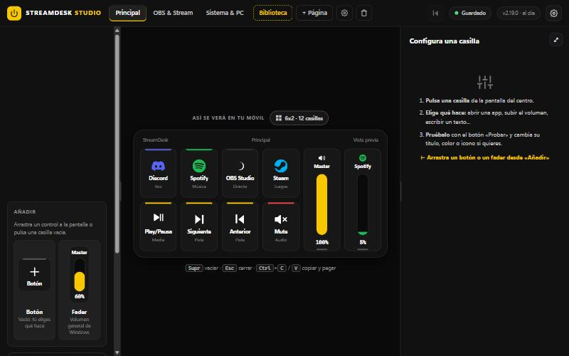
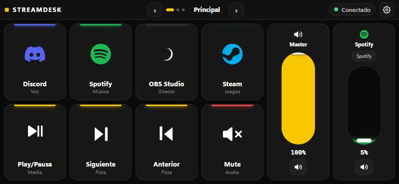
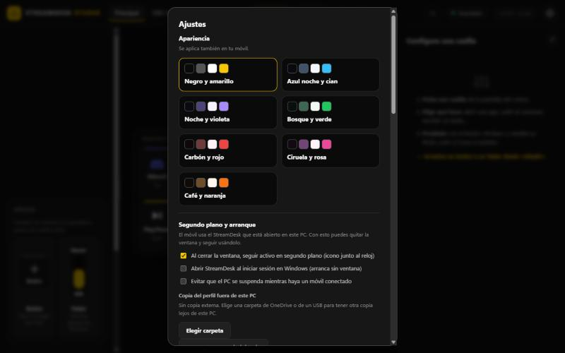

# StreamDesk Pro

**Convierte tu móvil en un panel táctil para tu PC con Windows:** botones, faders de volumen, y control de OBS, Spotify, Discord y de cualquier programa.

[](https://github.com/Zak208/streamdeck/releases/latest)
[](https://github.com/Zak208/streamdeck/actions/workflows/tests.yml)

[](installer/license.txt)



## Qué es

StreamDesk corre en tu PC y le sirve a tu móvil, por la Wi-Fi, una cuadrícula de botones y faders. Cada casilla puede abrir una app, pulsar un atajo, escribir un texto, controlar OBS, Spotify o Discord, cambiar el volumen de una aplicación o lanzar varias acciones seguidas. Lo diseñas en **Studio**, el editor de la aplicación de escritorio, y el móvil lo usa como un periférico táctil.

No hay cuenta de StreamDesk ni servidor propio: el móvil habla directamente con tu PC, dentro de tu red.

| En el móvil (horizontal) | Ajustes en Studio |
|---|---|
|  |  |

## Empezar en tres minutos

Necesitas un PC con **Windows 10 u 11** y un móvil en la **misma Wi-Fi**.

1. **Instala StreamDesk en el PC.** Descarga `instalador_streamdeck.exe` de la [última versión](https://github.com/Zak208/streamdeck/releases/latest) y ejecútalo. No pide permisos de administrador. Mientras el instalador no esté firmado, Windows puede avisarte: pulsa *Más información* y *Ejecutar de todas formas*.
2. **Abre StreamDesk Pro.** Verás Studio, con un código QR y un PIN en el panel de la izquierda.
3. **Conecta el móvil.**
   - **Android (recomendado):** descarga `StreamDesk.apk` de la misma versión, ábrelo y escanea el QR de Studio. La app recuerda tu PC y lo vuelve a encontrar sola si cambias de Wi-Fi.
   - **iPhone u otro móvil:** escanea el QR con la cámara. Para tenerlo como icono: en Safari, *Compartir > Añadir a pantalla de inicio*.
4. **Introduce el PIN** una sola vez, si te lo pide. Ya puedes pulsar botones.

Todos los detalles (Chrome como app, usarlo fuera de casa, móvil en vertical) están en [Usar StreamDesk en el móvil](docs/movil.md).

## Funciona como una app de PC

- **Cierra la ventana y sigue funcionando.** La X oculta StreamDesk en el icono junto al reloj, y el móvil sigue conectado. Para abrirlo, pulsa el icono; para cerrarlo del todo, elige *Salir* en su menú.
- **Arranca con Windows, sin ventana,** en las instalaciones nuevas. Se cambia en *Ajustes > Segundo plano y arranque* o desde el menú del icono.
- **El menú del icono** muestra cuántos móviles hay conectados, el QR para emparejar uno nuevo y copia la dirección del móvil.
- **Una sola copia a la vez:** si lo abres otra vez, trae al frente la que ya está abierta.
- **Opcional:** evitar que el PC se suspenda mientras haya un móvil conectado, y copiar tu perfil a una carpeta de OneDrive o de un USB cada vez que guardas.
- **Avisos de Windows** cuando se empareja un móvil nuevo y cuando hay una versión nueva.

## Qué puedes hacer

- **Botones y acciones:** abrir cualquier app instalada (programas, apps de la Tienda y juegos de Steam), atajos de teclado, escribir texto, abrir webs y carpetas, multiacciones con esperas, botones de dos estados, y acciones distintas para pulsación larga y doble toque.
- **Audio:** faders para el volumen general y para cada aplicación, silenciar el micro o una app, y cambiar de salida de audio.
- **Páginas:** más de 50 ya montadas en la **Biblioteca** (Streamer, OBS, Zoom, Photoshop, Excel, VS Code...), plantillas, y **páginas inteligentes** que se abren solas según el programa que uses. La cuadrícula es a tu medida (de 2 a 10 columnas y de 2 a 8 filas).
- **Conectores:** OBS, Spotify, Discord (silenciar y soundboard) y Windows. Ver [Conectores](docs/conectores.md).
- **Monitores en vivo:** CPU, RAM, GPU y VRAM (NVIDIA), red y disco.
- **Comodidad:** siete temas de color, guardado automático, deshacer con `Ctrl+Z`, y guardar o cargar copias de tu perfil.

La referencia completa de Studio, gestos, cuadrícula y acciones está en la [Guía de uso](docs/guia-de-uso.md).

## Seguridad en pocas líneas

- **Studio solo se abre desde el propio PC.** Cualquier otro dispositivo recibe un error 403 en las rutas de administración, y otras webs no pueden usar `localhost`.
- **El móvil se empareja con un PIN** de 6 dígitos, con límite de 5 intentos por dirección IP cada 10 minutos. Puedes quitar un móvil, o **limitarlo** para que no pueda apagar el PC ni lanzar comandos. Un móvil sin usar 90 días se desempareja.
- **Lo peligroso está apagado por defecto:** apagar o reiniciar el PC y los comandos de consola no funcionan hasta que los actives, los webhooks solo llaman a los destinos que permitas, y el móvil siempre pide confirmación antes de apagar.
- **Las contraseñas y tokens** de OBS y Spotify se guardan cifrados con Windows.
- **Lo que falta, dicho claramente:** el tráfico entre el móvil y el PC va por HTTP, sin cifrar. Úsalo en redes de confianza.

Más detalle y los límites conocidos en [Seguridad](docs/seguridad.md).

## Si el móvil no conecta

1. Comprueba que el móvil está en la **misma Wi-Fi** que el PC (no en datos móviles ni en una red de invitados).
2. En Studio, abre *Ajustes > Conexión del móvil > **Comprobar la conexión***. Revisa la red y el cortafuegos y te dice qué hacer. La causa más habitual es el cortafuegos de Windows: el botón *Permitir conexión del móvil* abre el aviso de Windows y solo abre el puerto a tu red local.
3. Si cambiaste de Wi-Fi o el PC cambió de dirección, la app de Android lo busca sola; en el navegador, escanea el QR otra vez.
4. Si al abrir StreamDesk aparece un aviso de que el puerto 48291 está ocupado, cierra el programa que nombra el aviso y vuelve a abrirlo.
5. Para pedir ayuda, pulsa **Copiar el diagnóstico** en la misma sección y pégalo en un [issue](https://github.com/Zak208/streamdeck/issues). No incluye PIN, tokens ni contraseñas.

## Actualizaciones

Studio y Windows avisan cuando hay una versión nueva. Al pulsar **Actualizar**, StreamDesk descarga el instalador de la Release, comprueba su huella SHA-256, se instala encima y se reinicia solo. Tu perfil, tus ajustes y tus móviles emparejados no se tocan. Cómo se publican las versiones está en [Actualizaciones y publicación](docs/actualizaciones-y-publicacion.md).

## Documentación

| Documento | Qué cuenta |
|---|---|
| [Usar StreamDesk en el móvil](docs/movil.md) | Instalar la app, Chrome, iPhone, fuera de casa |
| [Guía de uso](docs/guia-de-uso.md) | Studio, acciones, gestos, páginas, cuadrícula y monitores |
| [Conectores](docs/conectores.md) | OBS, Spotify, Discord y Windows, con sus requisitos y límites |
| [Seguridad](docs/seguridad.md) | Cómo se protege, control de móviles y límites conocidos |
| [Actualizaciones y publicación](docs/actualizaciones-y-publicacion.md) | Cómo se actualiza la app y cómo publicar una versión |
| [Desarrollo](docs/desarrollo.md) | Ejecutar desde el código, estructura, pruebas y compilación |

## Desarrollo

```powershell
git clone https://github.com/Zak208/streamdeck.git
cd streamdeck
.\start.ps1                              # crea el entorno, instala lo necesario y abre Studio en el navegador
.venv\Scripts\python.exe app_desktop.py  # la ventana de escritorio, con su icono en la bandeja
.venv\Scripts\python.exe -m unittest discover -s tests   # pruebas
```

Python 3.12, FastAPI y PyWebView con WebView2. Estructura, pruebas y compilación en [Desarrollo](docs/desarrollo.md).

## Licencia

MIT. Consulta [license.txt](installer/license.txt). Repositorio oficial: [github.com/Zak208/streamdeck](https://github.com/Zak208/streamdeck).
